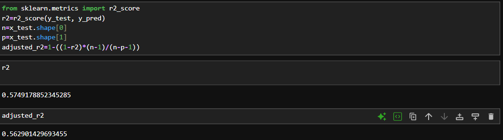

#  House Price Prediction using Linear Regression

A beginner-level supervised Machine Learning project that predicts house prices using **Linear Regression**.

This project was created as my first hands-on ML project to understand the complete workflow of a supervised learning problem — from data cleaning and feature selection to model training and evaluation.

##  Project Objective

The objective of this project is to predict the **SalePrice** of a house based on selected numerical features from the dataset.

##  Dataset

The dataset contains **2,919 rows and 13 columns**.

The target variable is:

- `SalePrice` — the price of the house

For this project, only the rows where `SalePrice` was available were used for training and evaluation.

##  Features Used

Since categorical encoding was not part of the current learning stage, categorical features were excluded.

The numerical features used were:

- `LotArea`
- `OverallCond`
- `YearBuilt`
- `YearRemodAdd`
- `BsmtFinSF2`
- `TotalBsmtSF`

The `Id` column was removed because it is only an identifier.

##  Data Preprocessing

The following preprocessing steps were performed:

1. Removed rows where `SalePrice` was missing.
2. Removed the `Id` column.
3. Removed categorical columns that require encoding.
4. Selected numerical features for the model.
5. Split the dataset into input features (`X`) and target (`y`).
6. Split the data into training and testing sets.

##  Machine Learning Model

The model used in this project is:

**Linear Regression**

Linear Regression was chosen because this is my first supervised Machine Learning project and it helped me understand the fundamentals of regression and model evaluation.

##  Model Evaluation

The model was evaluated using:

- **R² Score**
- **Adjusted R² Score**

### Result

**R² Score: 0.54**

This means that the model explains approximately 54% of the variation in house prices on the test data.

The score provides a baseline that can be improved in future versions by using better feature selection, categorical encoding, and more advanced regression algorithms.


## Technologies Used

- Python
- Pandas
- NumPy
- Matplotlib
- Scikit-learn
- Jupyter Notebook

##  Project Structure

```text
house-price-prediction/
│
├── house_price_prediction.ipynb
├── HousePricePrediction.csv
└── README.md
